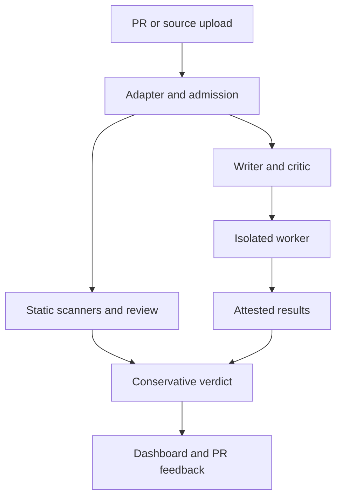

# Crucible — security scanning and test orchestration

[](https://github.com/dcw06/Crucible-Updated-7-30-/actions/workflows/ci.yml)

A multi-agent application for reviewing source submissions and pull requests, generating requirement-linked tests, and combining scanner findings with independently verified execution evidence. Incomplete required analysis produces a failure or review state rather than an implicit pass.

**[Application guide](crucible/README.md) · [CI](https://github.com/dcw06/Crucible-Updated-7-30-/actions) · [Browser worker](browser-worker/README.md) · [Desktop worker](desktop-worker/README.md)**

This is the expanded implementation. The [older Crucible repository](https://github.com/dcw06/Crucible) remains available as the original PR-pipeline prototype.

## Architecture



Semgrep, OSV-Scanner, ClamAV, and model review report their own coverage/status. Remote workers bind results to the target, nonce, plan, policy, and evidence digests. Test Cloud publishes and confirms execution results; missing verified sandbox evidence prevents automatic approval.

## Run locally

```bash
git clone https://github.com/dcw06/Crucible-Updated-7-30-.git
cd Crucible-Updated-7-30-
make setup
cp .env.example .env
make test
make web
```

`make web` binds the development scanner to `127.0.0.1`. Production requires scanner authentication and operational scanning dependencies. Credentials and native scanners are documented in the [application guide](crucible/README.md); do not expose the development profile publicly.

## Verify

```bash
make check
make build-workers
```

CI checks Python 3.11/3.14 and Node 20/22, dependency audits, Python tests, TypeScript builds/tests, and worker-image builds. Passing CI does not show that generated tests detect every defect or that every worker capability has been deployed.

## Workspace map and attribution

| Path | Status |
|---|---|
| `crucible/` | Main application; an ordinary tracked directory, not a Git submodule |
| `browser-worker/`, `desktop-worker/` | Separate execution/inspection services |
| `code_pipeline.py`, `research_pipeline.py` | Earlier prototypes |
| `mcp-server/`, `vscode-extension/` | Interfaces to the earlier Writer/Critic loop |

Maintained by Chongwei (Alan) Dai. Upstream scanner/model work is credited separately; AI coauthor attribution remains in Git history. See [LICENSE](LICENSE).

## Evidence and limitations

- Verdicts describe completed checks and their coverage, not a security certification.
- The weighted confidence score is a policy heuristic, not a calibrated probability of correctness.
- There is no published defect-detection benchmark in this checkout; no universal test-quality or edge-case coverage guarantee is made.
- Live model calls, Test Cloud, and platform worker deployments need separate configuration. The local setup is not a hosted demo.
- The [workspace manual](docs/WORKSPACE.md) retains supporting development details; the [application guide](crucible/README.md) describes current trust boundaries.
